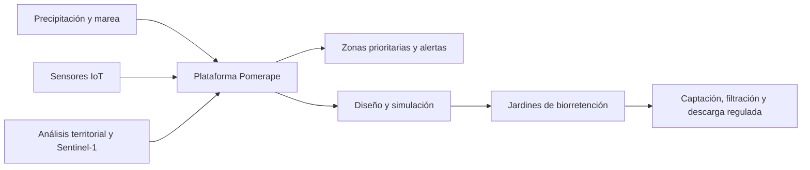

# RED BIOESPONJA AMAZÓNICA

## Proyecto y reconocimiento

RED BIOESPONJA AMAZÓNICA fue desarrollada por **Pomerape**, equipo representante de la **Universidad de Tarapacá** en el **Rally Latinoamericano de Innovación 2026**. Durante 28 horas de trabajo multidisciplinario, el equipo diseñó una solución para las inundaciones urbanas de **Belém do Pará, Brasil** y obtuvo el **1.er lugar en la categoría Impacto Social de su sede**.

La solución articula infraestructura verde, monitoreo inteligente, análisis satelital y una plataforma digital para observar el comportamiento del agua, priorizar intervenciones y apoyar alertas tempranas.

## Problema abordado

En Belém, la acumulación de agua durante eventos de lluvia afecta la movilidad y la vida cotidiana de las comunidades. El comportamiento del drenaje y las mareas añade complejidad a la respuesta. RED BIOESPONJA AMAZÓNICA conecta datos, territorio y diseño de infraestructura para comprender estos factores en conjunto.

## Cómo funciona

### Monitoreo y análisis territorial

La red de monitoreo reúne niveles de agua, precipitación y condiciones de drenaje. La lectura de puntos aguas arriba y aguas abajo ayuda a reconocer cambios compatibles con saturación u obstrucciones. El análisis territorial incorpora topografía, cartografía y radar Sentinel‑1 para apoyar la identificación de sectores vulnerables.

### Infraestructura verde

Las bioesponjas son jardines de biorretención distribuidos en corredores urbanos. Reciben escorrentía, la almacenan temporalmente, favorecen su filtración y regulan su salida. El diseño modular permite adaptar la intervención al espacio disponible y al comportamiento del agua en cada sector.

### Plataforma y simulación

Pomerape integra un centro de control, mapa geoespacial, red de monitoreo, configuración de infraestructura verde, simulador, alertas e informes. Los escenarios de lluvia y marea permiten visualizar la entrada, almacenamiento, infiltración, descarga y eventual rebalse de una bioesponja, además de comparar alternativas de intervención.

## Recorrido de uso

1. Revisar los indicadores y el mapa en el **Centro de control**.
2. Seleccionar un evento de lluvia y una zona en el **Mapa de decisión pluvial**.
3. Examinar el drenaje y las lecturas en la **Red de monitoreo**.
4. Configurar una bioesponja en **Infraestructura verde**.
5. Probar el comportamiento del sistema en el **Modelo de bioesponja**, incluyendo la condición de marea.
6. Consultar **Alertas** e **Informes** para comunicar el escenario y dar seguimiento.

## Aporte del proyecto

El proyecto une ingeniería civil, computación e informática, análisis de datos y diseño ambiental en una misma experiencia. La plataforma hace visible la relación entre lluvia, territorio, drenaje e intervención, de modo que el equipo pueda explicar sus decisiones y compartirlas con las comunidades y actores responsables.

## Enlaces de esta documentación

- [Volver al README](../README.md)
- [Arquitectura y ejecución](ARQUITECTURA.md)
